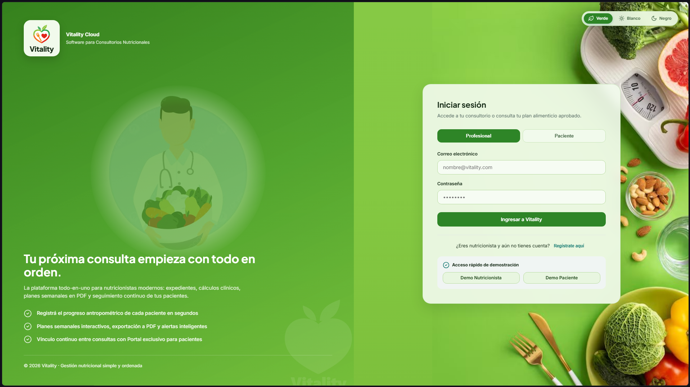
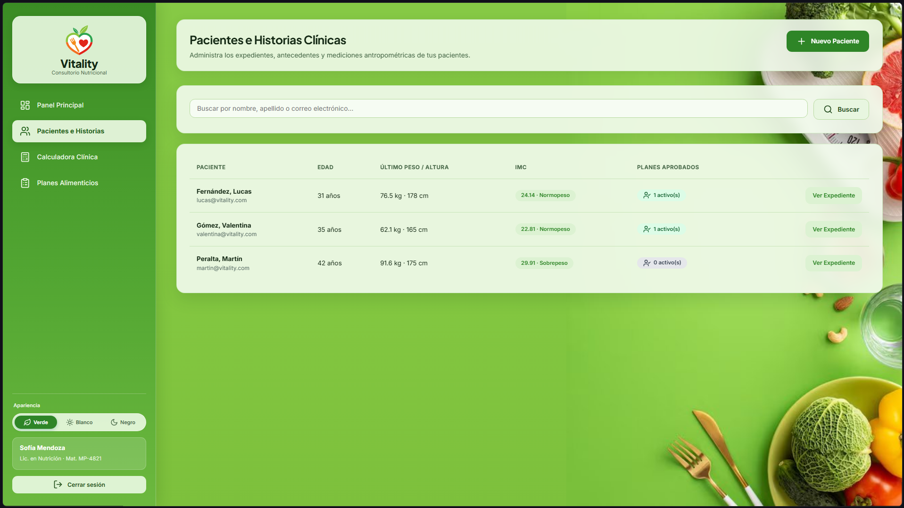
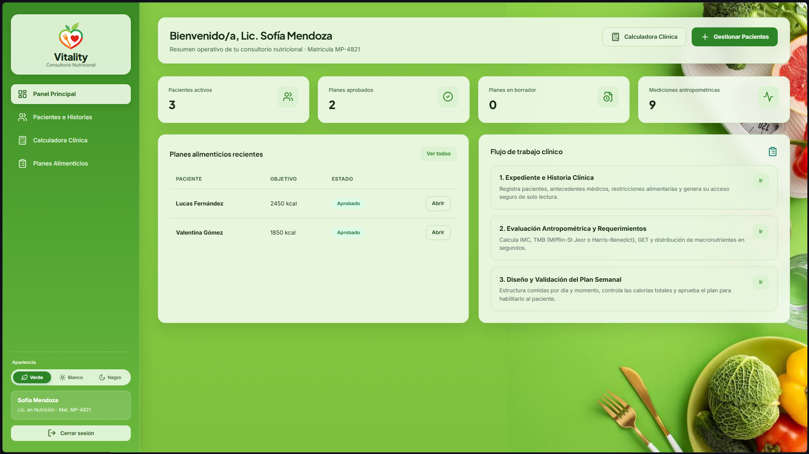
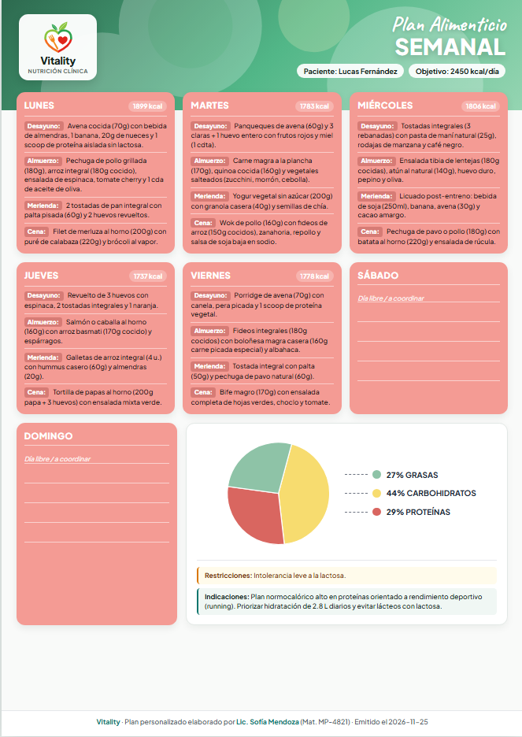
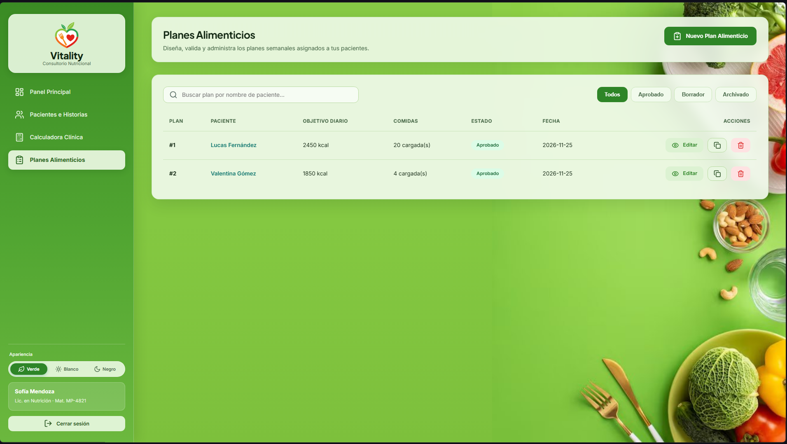

# Vitality — Plataforma Web de Gestión Integral para Consultorios Nutricionales

Sistema web full-stack diseñado para centralizar la gestión operativa de consultorios nutricionales, con **segregación estricta de roles** mediante JWT:
- **Profesional (Lic. en Nutrición):** CRUD completo de pacientes, historias clínicas, evolución antropométrica, calculadora nutricional clínica y diseño/aprobación de planes alimenticios semanales.
- **Paciente:** Portal de **solo lectura** para consultar sus planes aprobados, balance de macronutrientes, exportación a PDF y seguimiento de evolución antropométrica.

---

## Capturas







## Funcionalidades Principales

- **Autenticación y roles con JWT + bcryptjs** (soporte multi-profesional: cada nutricionista gestiona su propio consultorio aislado).
- **Gestión de Pacientes e Historia Clínica:** antecedentes médicos, restricciones alimentarias y generación de acceso para el paciente.
- **Seguimiento Antropométrico:** registro histórico de peso, altura, IMC automático, % de grasa y masa muscular, con gráficos interactivos y **deltas acumulados de progreso**.
- **Calculadora Nutricional Clínica:** cálculo de IMC, TMB (*Mifflin-St Jeor* y *Harris-Benedict*), GET y distribución de macronutrientes con creación directa de planes.
- **Editor de Planes Alimenticios Semanales:**
  - Comidas organizadas por día (`Lunes`–`Domingo`) y momento (`Desayuno` a `Colación`).
  - Control de estado (`Borrador`, `Aprobado`, `Archivado`), **duplicación de planes** y **copia de días**.
  - **Plantillas rápidas de comidas** precargables en 1 clic.
  - **Alertas preventivas** de desvío calórico (>±10%) y cruce con restricciones alimentarias.
  - **Exportación a PDF** con diseño visual de lámina semanal y gráfico de torta de macronutrientes.
  - Aviso rápido al paciente por **WhatsApp Web**.
- **Personalización visual:** 3 modos de apariencia (**Verde**, **Blanco** y **Negro / Dark Mode**) con persistencia en `localStorage`.
- **Documentación interactiva de la API:** Swagger / OpenAPI en `/api-docs`.

---

## Arquitectura y Stack Tecnológico

| Capa | Tecnologías |
| :--- | :--- |
| **Frontend** | React 18, Vite 6, React Router v6, Lucide React, CSS Variables |
| **Backend** | Node.js (ESM), Express 4, JWT (`jsonwebtoken`), `bcryptjs`, `swagger-ui-express` |
| **Base de Datos** | MySQL (`mysql2/promise`) — Esquema relacional de 5 tablas (`Profesionales`, `Pacientes`, `Registros_Antropometricos`, `Planes_Alimenticios`, `Detalles_Comidas`) |

---

## Instalación y Puesta en Marcha Local

### Requisitos previos
- **Node.js** 18 o superior
- **MySQL** 8.0 (o XAMPP / MariaDB) corriendo en `localhost:3306`

### 1. Clonar el repositorio
```bash
git clone https://github.com/jimy98/vitality.git
cd vitality
```

### 2. Configurar el Backend y la Base de Datos
```bash
cd backend
cp .env.example .env
```
Editá `backend/.env` con tus credenciales de MySQL (`DB_USER`, `DB_PASSWORD`, `DB_HOST`, `DB_PORT`) y luego ejecutá:
```bash
npm install
npm run init-db
npm start
```
- API disponible en: `http://localhost:4000`
- Documentación Swagger: `http://localhost:4000/api-docs`

### 3. Configurar y levantar el Frontend
En otra terminal:
```bash
cd frontend
npm install
npm run dev
```
- Aplicación web disponible en: `http://localhost:5173`

### Credenciales de demostración (cargadas por `npm run init-db`)
- **Profesional:** `nutricionista@vitality.com` / `vitality123`
- **Paciente:** `lucas@vitality.com` / `paciente123`

---

## Equipo de Desarrollo

| Integrante | Usuario de GitHub |
| :--- | :--- |
| **Mercado Cáceres José Gustavo** | [@jimy98](https://github.com/jimy98) |
| **Ruiz Santino Santiago** | [@Santino07-byte](https://github.com/Santino07-byte) |
| **Ignacio Agustín Mercado** | [@NachoEmme7](https://github.com/NachoEmme7) |
